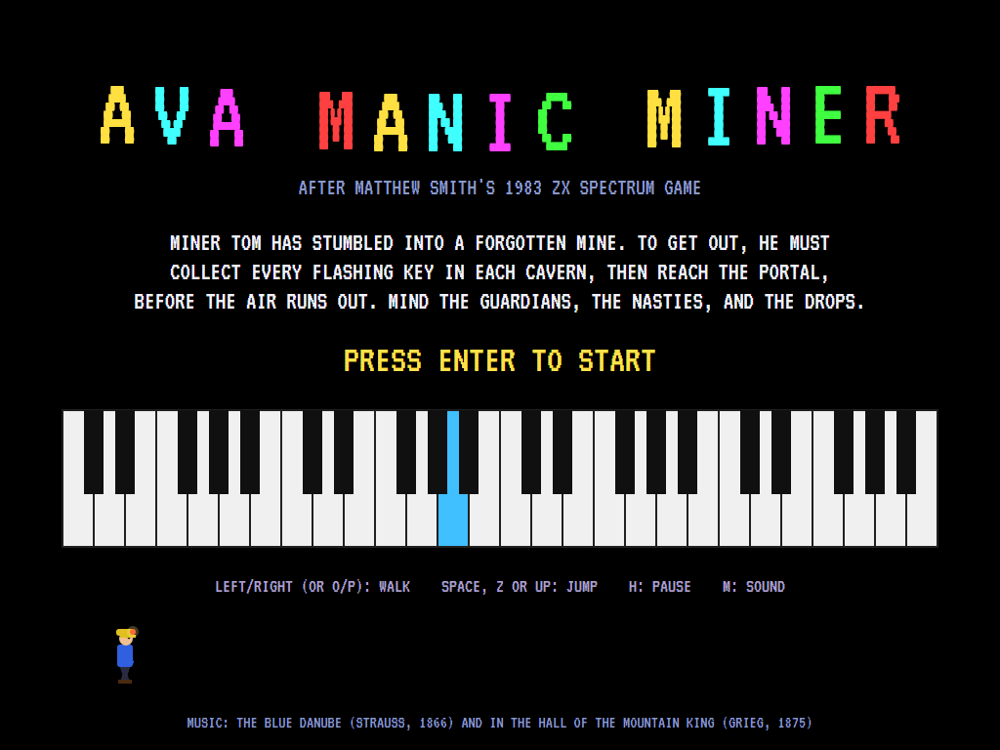
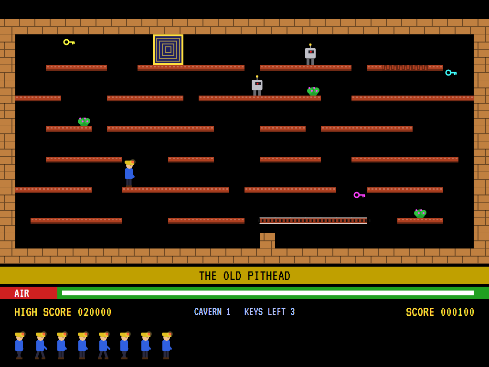
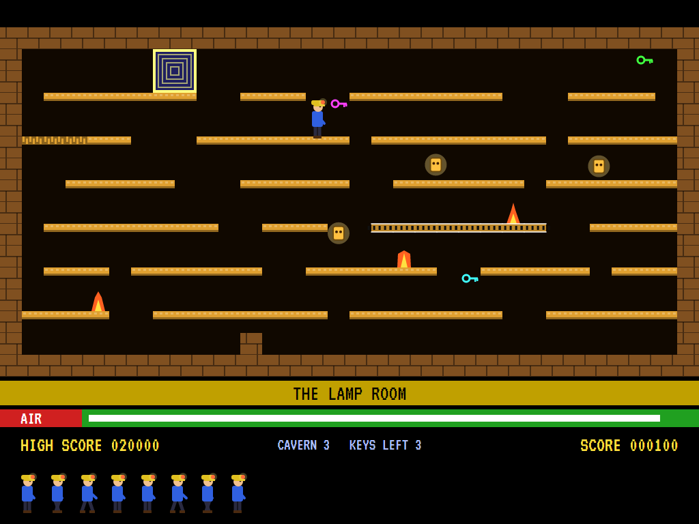
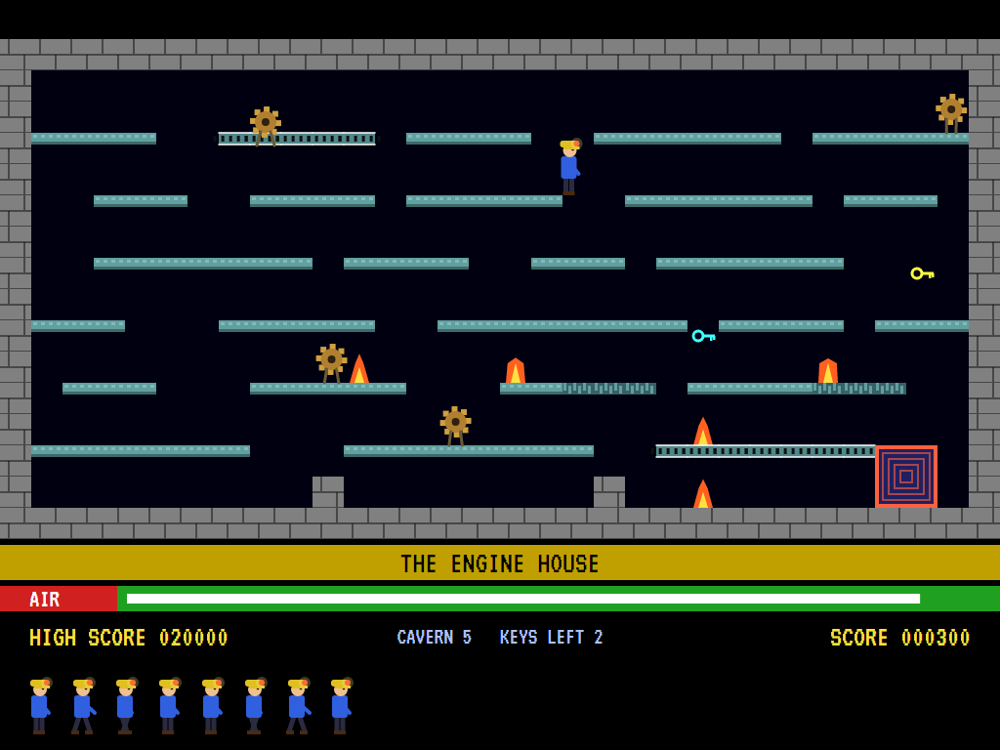
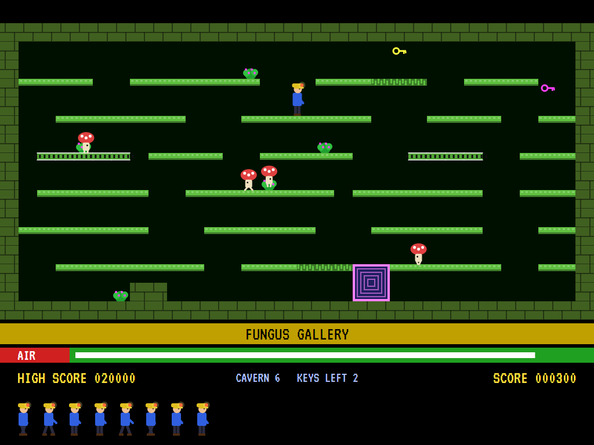
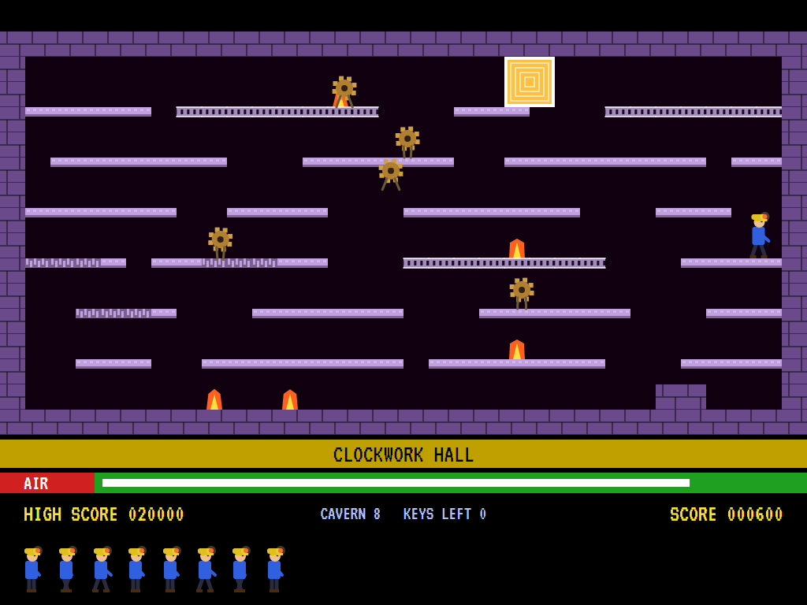
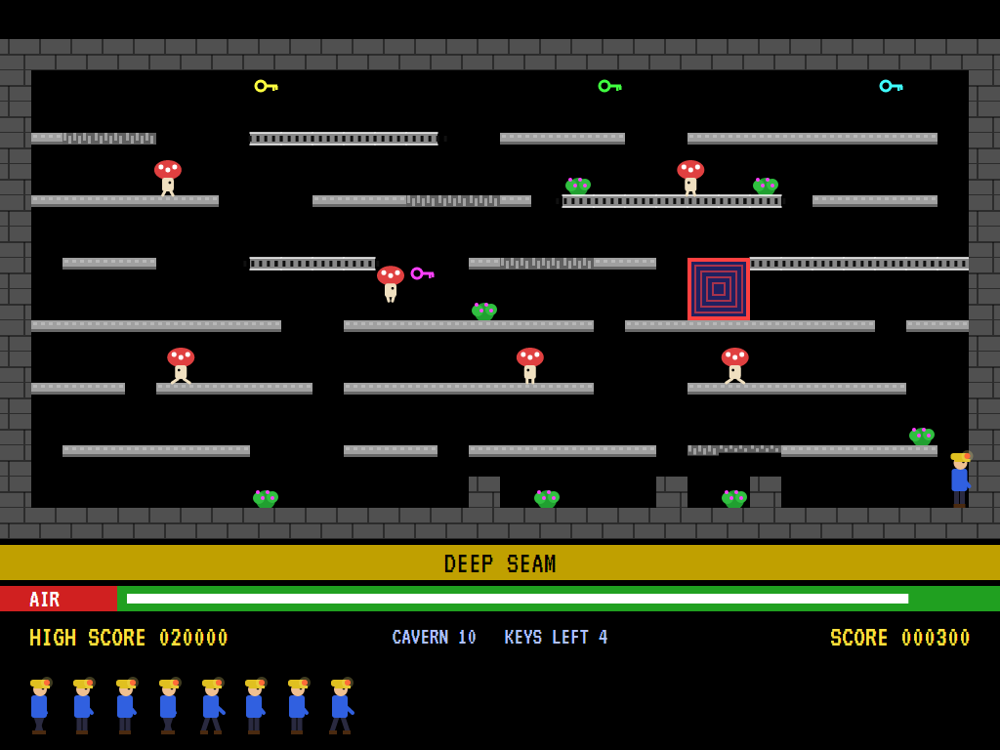
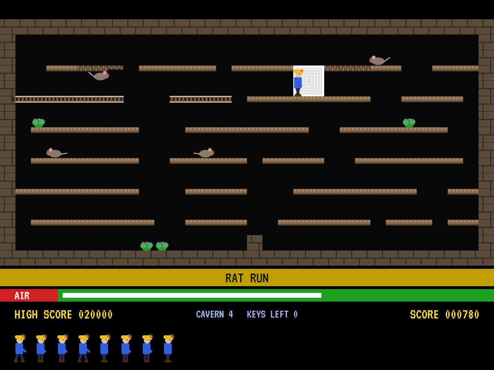
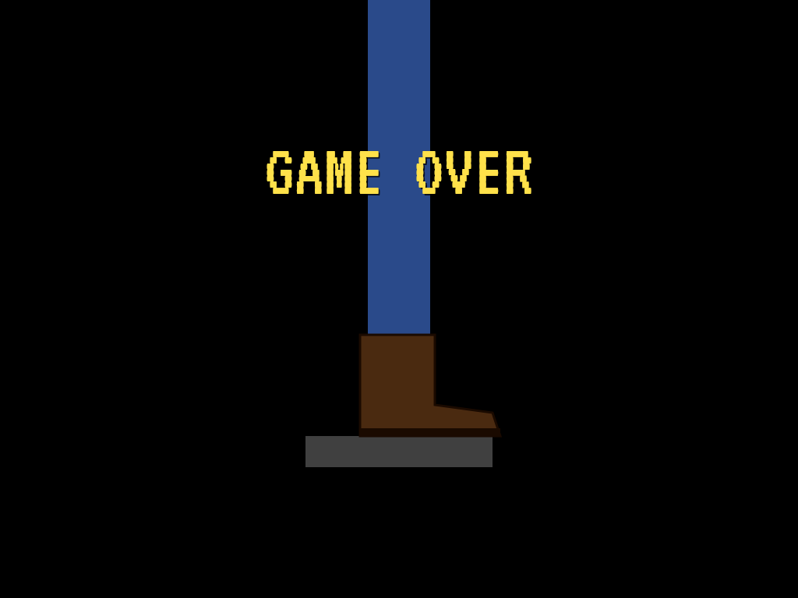
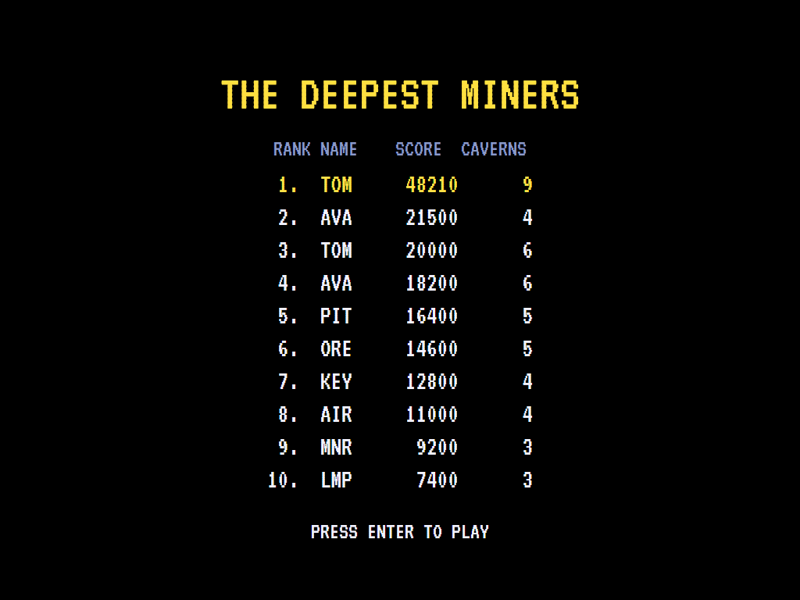

# AVA Manic Miner

[](https://github.com/Harlock123/AVAManicMiner/actions/workflows/build.yml)

A flick-screen platform game in the style of Matthew Smith's 1983 ZX Spectrum game **Manic Miner**, built
with .NET 10 and Avalonia UI. Miner Tom has stumbled into a forgotten mine. To get out he must work through
ten caverns. In each one he collects every flashing key, then reaches the portal before the air runs out.
Guardians patrol the ledges, poisonous plants grow in the corners, conveyors carry him where he'd rather not
go, and some ledges crumble under his boots.

## Features

- **Ten caverns**, each with its own name and colours: The Old Pithead, Frost Hollow, The Lamp Room, Rat Run,
  The Engine House, Fungus Gallery, The Sluice, Clockwork Hall, The Furnace and Deep Seam. Each has more
  keys, more guardians and less air than the one before.
- **Every cavern is proved**: it's built from its own seed, then the game works out every place Miner Tom
  can stand and where each walk or jump takes him, using its own physics. A cavern is kept only if every key
  and the portal can be reached, with no dead ends, and a way round every guardian's beat.
- **Miner Tom walks and jumps.** A jump is a fixed arc that can't be steered once it starts. A drop of more
  than four squares is the end of him.
- **The cavern:** brick walls, ledges he can jump up through, **conveyors** that carry him (pushing against
  one only holds him still), **crumbling ledges** that give way, and **nasties** that kill at a touch.
- **Guardians:** robots, penguins, lamps, rats, engines and toadstools patrol to and fro along the ledges,
  and from the third cavern on another drops up and down a shaft.
- **The air** runs down. When it runs low, a voice says "Air!". Through the portal, whatever air is left is
  counted into the score. Every 10,000 points is another miner.
- **Game over** comes under a giant boot.
- **Music:** *In the Hall of the Mountain King* (Grieg) in the caverns and *The Blue Danube* (Strauss) on
  the title screen, both public domain, arranged for two bleeping voices. The title screen has a piano
  keyboard that plays along.
- **The attract mode** shows the computer miner at work. It plans the quickest way to the nearest key on its
  map of the cavern, keeping off the guardians' beats where it can. It plays each move out on a copy of the
  cavern first, and if a guardian would catch it, it waits for the moment it wouldn't.

## Screenshots

| The title | The Old Pithead | A jump |
|:---------:|:---------------:|:------:|
|  |  |  |
| The piano plays along. | The first key taken. | In The Lamp Room. |

| The Engine House | Fungus Gallery | The portal open |
|:----------------:|:--------------:|:---------------:|
|  |  |  |
| Conveyors and crumbling ledges. | Toadstools on patrol. | Every key taken, in Clockwork Hall. |

| Deep Seam | Air counted in | Game over |
|:---------:|:--------------:|:---------:|
|  |  |  |
| The tenth cavern. | Into the portal in Rat Run. | The boot. |



The screenshots are made by the tests, which play the game in a real (headless) window; see
[Tests](#tests).

## Download and run

Ready-to-run builds for Windows, macOS and Linux, on both Intel/AMD and ARM, are on the
[Releases page](https://github.com/Harlock123/AVAManicMiner/releases/tag/latest). **Latest build** is
rebuilt on every push to `main`. Each download is one self-contained executable: no .NET install is
needed.

| Platform | Archive |
|---|---|
| Windows | `AVAManicMiner-win-x64.zip`, `AVAManicMiner-win-x86.zip`, `AVAManicMiner-win-arm64.zip` |
| macOS | `AVAManicMiner-osx-arm64.tar.gz` (Apple silicon), `AVAManicMiner-osx-x64.tar.gz` (Intel) |
| Linux | `AVAManicMiner-linux-x64.tar.gz`, `AVAManicMiner-linux-arm64.tar.gz`, `AVAManicMiner-linux-arm.tar.gz` |

```bash
tar -xzf AVAManicMiner-linux-x64.tar.gz     # or linux-arm64, linux-arm, osx-arm64, osx-x64
./AVAManicMiner
```

On Windows, unzip and run `AVAManicMiner.exe`. On macOS, if Gatekeeper refuses to open it, run
`xattr -d com.apple.quarantine AVAManicMiner` once. Run with `--no-audio` for silence.

**Sound** comes through OpenAL Soft, built in for every platform. In a virtual machine the game
detects it and uses a larger audio buffer, so the sound doesn't break up.

**Gamepads** use SDL2, which is bundled for Windows, macOS and Intel/AMD Linux. ARM Linux builds need it
installed; without it the keyboard still works:

```bash
sudo apt install libsdl2-dev            # Debian / Ubuntu / Raspberry Pi OS
sudo pacman -S --needed sdl2-compat     # Arch / Omarchy
```

## Controls

| Action | Keyboard | Gamepad |
|---|---|---|
| Start | Enter or 1 | Start |
| Walk | Left/right arrows, O/P or A/D | Left stick / D-pad |
| Jump | Space, Z, X, W or Up | A, B, X or up |
| Pause | H or Esc | Start or Back |
| Sound on/off | M | |
| Screenshot | Ctrl+S (to your Pictures folder) | |

On the high-score table, type your initials, or use up/down and Space, then Enter.

## Tests

```bash
dotnet test AVAManicMiner.slnx
```

The game runs in fixed 60 Hz steps, so it plays the same at any frame rate. Everything that moves or
changes lives in one world that can be copied. The tests check:

- **The caverns:** ten of them, each harder than the last. From the start, every key and the portal can be
  reached. The computer miner clears every cavern, losing no more than one life. Standing still, or running
  right and jumping blindly, gets nowhere.
- **Walking and jumping:** a steady pace and brick that stops it; a jump that is a fixed arc, two squares up
  and three across, whatever is pushed mid-air; holding jump jumps only once; up through a ledge and onto
  it; brick overhead cutting a jump short; a short drop survived and a long one not.
- **The cavern:** a conveyor carrying him, and holding him still when he pushes against it; a crumbling
  ledge giving way; a nasty; a guardian walking its beat, catching him, and jumped over; the air running
  out; the portal opening only when every key is taken.
- **The game:** caught, the cavern starts again with its keys back; through the portal, the air is counted
  in and the next cavern starts; an extra miner every 10,000; the last life lost under the boot, then the
  high-score table; the demonstration, and Enter to play; pause; the keys, through to the miner; the
  spoken air warning.

`tests/AVAManicMiner.Tests/PilotProbe.cs` reports how the computer miner gets on in each cavern, for tuning
(`MINER_PROBE=1`; `MINER_PROBE=lazy` for a miner who only runs right and jumps).

The screenshot tests draw the real screen in a headless window. To refresh the README's pictures:

```bash
MINER_SHOTS=$PWD/Images dotnet test tests/AVAManicMiner.Tests --filter ScreenshotTests
```

## Building

```bash
dotnet build AVAManicMiner.slnx
dotnet run --project src/AVAManicMiner
```

Needs the .NET 10 SDK. The sounds and tunes are made by `tools/make_sounds.py` (standard-library Python,
with the formant voice in `tools/speech.py`): `python3 tools/make_sounds.py` rewrites
`src/AVAManicMiner/Sounds`.

## Project structure

```
AVAManicMiner/
├── AVAManicMiner.slnx
├── src/AVAManicMiner/
│   ├── Engine/
│   │   ├── GameEngine.cs        # States, lives, caverns in turn, the air count, the title and demonstration
│   │   ├── Sim.cs               # A cavern step by step: walking, jumping, conveyors, crumbling, guardians
│   │   ├── World.cs             # Everything that moves or changes, kept together so it can be copied
│   │   ├── Cavern.cs            # Squares, how a cavern is built and proved, and the ten caverns
│   │   ├── Graph.cs             # Every place to stand, and where each move from it goes
│   │   ├── Pilot.cs             # The computer miner (the demonstration, and the tests)
│   │   ├── HighScoreTable.cs, InitialsEntry.cs
│   │   ├── InputHandler.cs, ControllerManager.cs  # Keys and an SDL2 gamepad
│   │   └── SoundManager.cs      # Effects and tunes through OpenAL
│   ├── Audio/                   # The OpenAL engine (from the author's AVABand)
│   ├── Views/                   # The drawing: caverns, the miner, guardians, the piano and the boot
│   └── Sounds/                  # The synthesised effects and tunes
├── tests/AVAManicMiner.Tests/   # Cavern, gameplay and screenshot tests
├── tools/make_sounds.py, tools/speech.py
└── Images/                      # Screenshots
```

## About and licence

AVA Manic Miner © 2026 Lonnie Watson, under the [MIT License](LICENSE).

*Manic Miner* © 1983 Matthew Smith (published by Bug-Byte, then Software Projects); the name belongs to its
current owner. AVA Manic Miner is an independent, unofficial game in its style. Its caverns, guardians,
graphics, sounds and code are its own; nothing is taken from the original game's program, graphics or
sound. The two tunes are public-domain classical pieces, arranged here. It is not affiliated with or
endorsed by any rights holder.
